# UI design system

The officer UI is built from one theme and one set of shared components, so every tab looks the same and the redesign issues (#17 console, #19 queue, #21 dashboard) only change layout. Added in #16.

| File | What it holds |
|---|---|
| `.streamlit/config.toml` | Theme: colours, fonts, radius, chart colours. Static serving for the bundled fonts. |
| `ui/components.py` | Tokens (`COLORS`, `STATUS`, `QUEUE_STATUS`) and every shared component |
| `ui/static/fonts/` | Noto Sans + Noto Sans Kannada (OFL), so the UI looks the same offline |
| `tests/test_ui_components.py` | Palette ↔ engine sync, contrast, escaping, theme ↔ tokens |

## Rules

1. **Build from the components.** If a tab needs something new, add it to `ui/components.py`, not inline HTML in the app.
2. **Status is never colour alone.** Every badge is icon + text. The palette is Okabe-Ito based (colour-blind safe) and every text/tint pair is at least 4.5:1 (WCAG AA); the tests enforce this.
3. **Escape everything.** Text from the API, the LLM or a user goes through the components, which HTML-escape it. Don't pass raw text to `st.markdown(..., unsafe_allow_html=True)`.
4. **A new engine status needs a style.** `test_every_engine_status_has_exactly_one_style` fails until `STATUS` has it.
5. **Check at 1366×768 (projector) and 820px (tablet).**

## Palette

Theme: primary `#1F4E8C` (passbook ink blue), background `#F7F9FB`, surface `#FFFFFF`, secondary `#EAEFF5`, text `#18202C`, muted `#5A6676`, border `#D5DDE8`.

| Status | Icon | Label | Text | Tint |
|---|---|---|---|---|
| `ELIGIBLE` | ✓ | Eligible | `#00684A` | `#E1F3EC` |
| `ELIGIBLE_BLOCKED` | → | Eligible – blocked | `#8A5300` | `#FDF0D9` |
| `NOT_ELIGIBLE` | ✕ | Not eligible | `#454E5C` | `#ECEEF2` |
| `UNKNOWN` | ? | Unknown | `#0B5A8F` | `#E3EFF8` |
| `ALREADY_ENROLLED` | ◆ | Already enrolled | `#7A3E66` | `#F6E8F1` |
| `VERIFY_MANUALLY` | ! | Verify manually | `#A33F00` | `#FBE6DA` |

Everything else that needs a colour (mode pill, fact chips, plan steps, the to-customer bubble) uses `TONE`, whose entries *are* `STATUS` entries. `test_one_palette_no_raw_hex_outside_the_token_tables` fails if a raw hex value appears outside the token tables.

Queue statuses (`queue_badge`) reuse the same tints: pending = blue, rejected / needs officer = vermilion, revised = orange, approved / submitted = green.

## Components

| Component | Use it for |
|---|---|
| `setup_page()` | First call in the app: wide layout + stylesheet |
| `app_header(...)` | Name, Kannada wordmark, tagline, mode pill, officer and branch |
| `section_header(title, caption)` | Every section title (native subheader + caption) |
| `status_badge(status)` / `queue_badge(status)` / `status_legend()` | Any status shown anywhere |
| `card_title(name, meta, badge_html, detail)` | Title row of any card |
| `product_card(result)` | One product: badge, benefit, an indicative value line (`value_line`) when `value_inr` is set and the status is ELIGIBLE, ELIGIBLE_BLOCKED or ALREADY_ENROLLED ("₹2,00,000 life cover (indicative)"; nothing when null or not eligible), "Why this status" with cited rules and source |
| `kpi_tiles([(label, value[, needs_attention])])` | KPI row; reflows on narrow screens. The dashboard's "₹ unlocked" / "₹ eligible, not yet enrolled" tiles use it with a caption "indicative cover / annual benefit" |
| `format_inr(n, compact=False)` | ₹ with Indian grouping ("₹4,12,000"); `compact=True` for tiles ("₹18.4 lakh", "₹1.2 crore") |
| `key_values(dict)` | Form payloads and profiles instead of raw JSON |
| `empty_state(title, hint)` | Any empty area: say what to do next |
| `customer_card(customer, blocked=None)` | One customer in the picker; returns True on "Start session" (#17). `blocked` (a reason) disables the button |
| `customer_bar(profile)` | Who is being served, plus the account / Aadhaar seeding / eKYC facts that block schemes |
| `product_grid(results, previous, action_labels)` | All products as cards; a card whose status changed pulses and says "Changed from … to …" |
| `question_prompt(text_en, text_kn)` | The question to ask now, pinned above the chat input |
| `customer_bubble(lang, text)` | Text the agent wrote for the customer, set apart from what it tells the officer |
| `plan_steps(state, action_labels)` + `stepper(steps)` | Numbered plan: approved steps ticked first, then each remaining step with its queue state |
| `pipeline(stages, notes, active_tool)` | CGI's Ingest → Decide → Act → Report from `GET /sessions/{id}/timeline`, with the tools used in each stage; mid-turn the latest tool is highlighted (#18) |
| `queue_group_header(name, meta, counts)` + `count_badges(counts)` | One customer's group in the approval queue, with status counts; escalations sort first (#19) |
| `rejection_note(reason, by)` + `revision_diff(rows)` | Why an item came back and what changed since: field, value at the rejection (struck through), value now. Rows come from `GET /queue/{id}/history` |
| `pdf_first_page_png(pdf)` | Page 1 of the real PDF as a PNG (pypdfium2), shown as a thumbnail with a "View page" popover; works offline and in any browser |
| `call_row(row, product_names)` + `opportunity_chip(o)` | One customer on the branch-scan call list: rank, "PM-KISAN at risk" if urgent, ✓/→ chips for what they could get (the tooltip shows each one's indicative ₹), the row's indicative ₹ total (`format_inr`, hidden when 0), the reason (#38) |
| `filter_call_list(rows, products, blockers, districts, urgent_only)` | Pure filter for the call list; keeps the scan's ranking |
| `funnel_chart(funnel)` + `funnel_rows` / `funnel_sentence` | Dashboard funnel (Altair): count, % of the previous stage, ₹ on eligible / approved; one generated sentence (#21) |
| `product_status_chart(by_product)` + `status_scale()` | 7 stacked bars coloured from `STATUS`; a `selection_point` named `product` for click-to-filter (#21) |
| `count_chart(rows, name)` + `panel_counts(rows, kind, labels)` | Panel bars (customers per rule / blocker / doc) with a click selection; counts each customer once (#21) |
| `filter_results(rows, product, detail)` + `result_table(...)` | Pure filter over `customer_results` and the "Customers in this view" rows ("—" for a null value) (#21) |
| `format_minutes(m)` · `state_chips(counts)` / `stage_chips(...)` | "—" / "<1 min" / "4 min" / "1 h 20 min"; sessions-by-stage chips, ESCALATED highlighted (#21) |
| `activity_feed(events)` + `event_label(event)` | Newest-first agent activity; each event opens a "why" drawer with what went in and what came out. Guardrail refusals show a shield and "Guardrail:" |

Header settings (env, optional): `YS_OFFICER_ID` (initial "Acting as" officer), `YS_BRANCH`.

**Acting as** (header): pick Banking Correspondent (maker) or Branch Manager (checker) from `GET /officers`. Queue cards show "Prepared by …". Approve / Reject are disabled, with a caption and tooltip saying why, when the current officer is a maker or prepared the item (maker-checker, enforced in `app/queue.py`). For the Branch Manager, **Start session** and **Save and send back** are locked too: whoever prepares or revises an item becomes its maker, and with a single checker nobody could then decide it.

## Officer console (#17)

The Ramesh walkthrough from `docs/DEMO.md`, in rules-only mode:

| Pick a customer | Session starts: statuses, question, account facts |
|---|---|
| 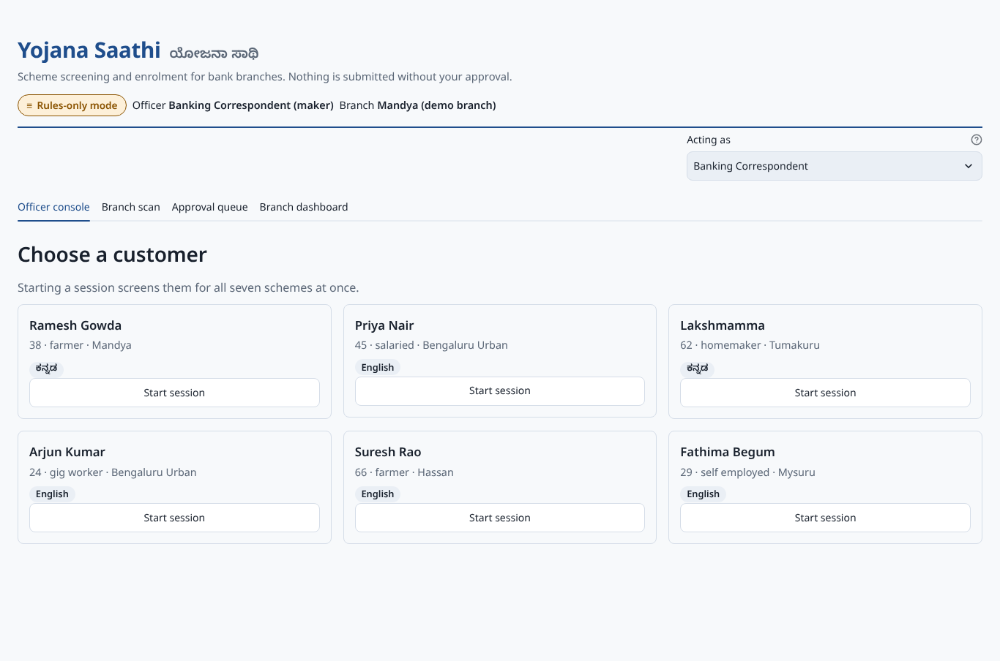 | 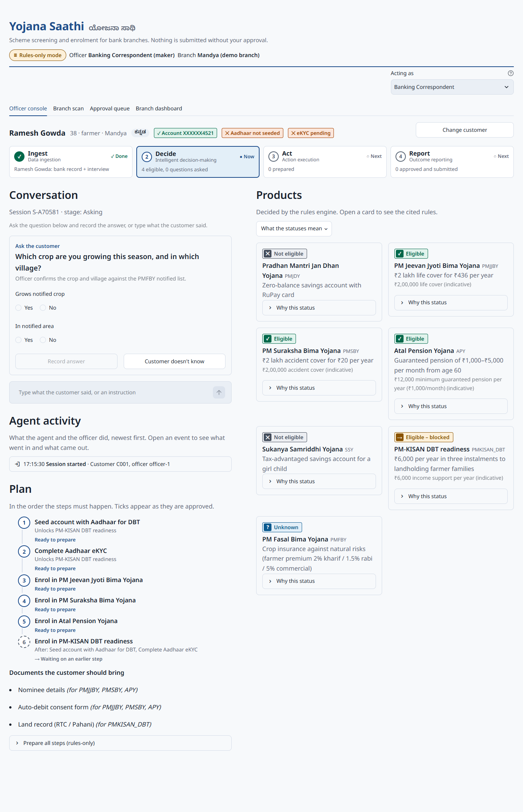 |
| **Answer recorded: PMFBY changes, plan appears** | **Seeding + eKYC approved: ticks, PM-KISAN unblocked** |
| 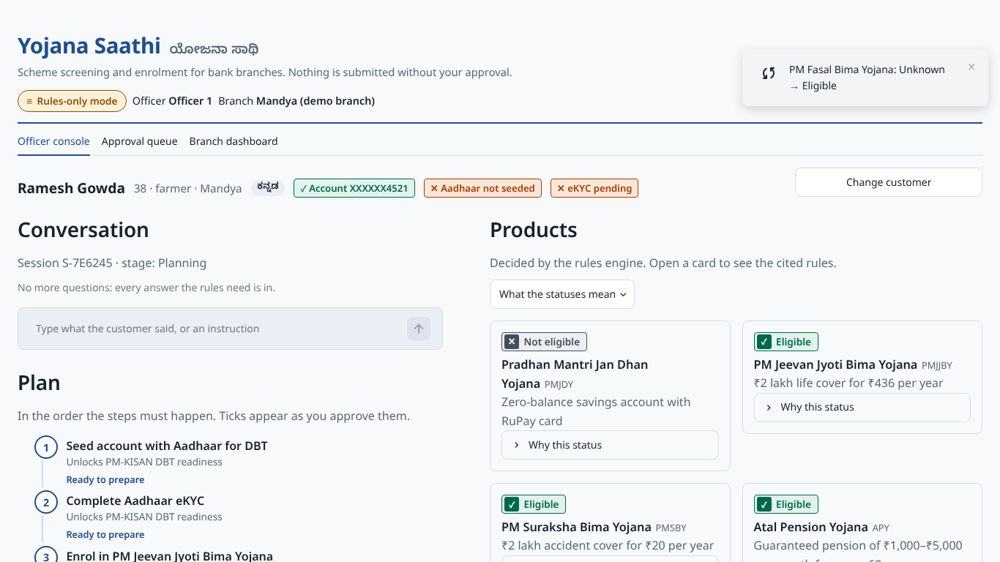 | 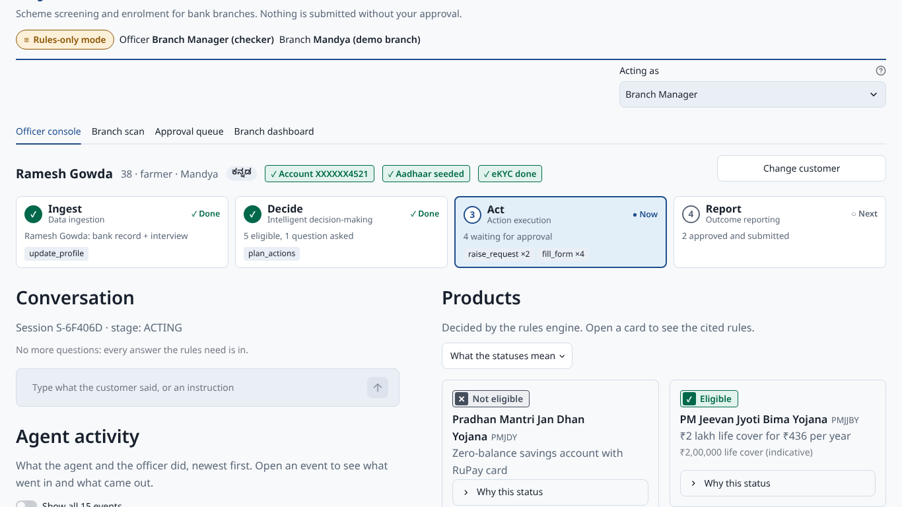 |

Status changes are announced three ways: the card pulses twice (skipped with reduced motion), the card says "Changed from … to …", and a toast names the product.

## Live agent pipeline (#18)

`POST /message` runs in a background thread; while it runs, the pipeline and the activity feed are Streamlit fragments that poll `GET /sessions/{id}/timeline` every second, so each tool call appears as it happens. The chat input and the answer buttons are disabled until the turn ends, then the whole console redraws with the new state.

| Mid-turn: stage and tools, live | After the turn: the "why" drawer of a guardrail refusal |
|---|---|
| 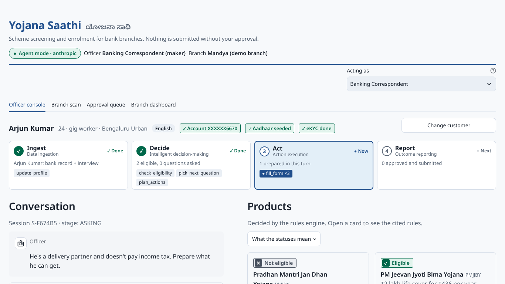 | 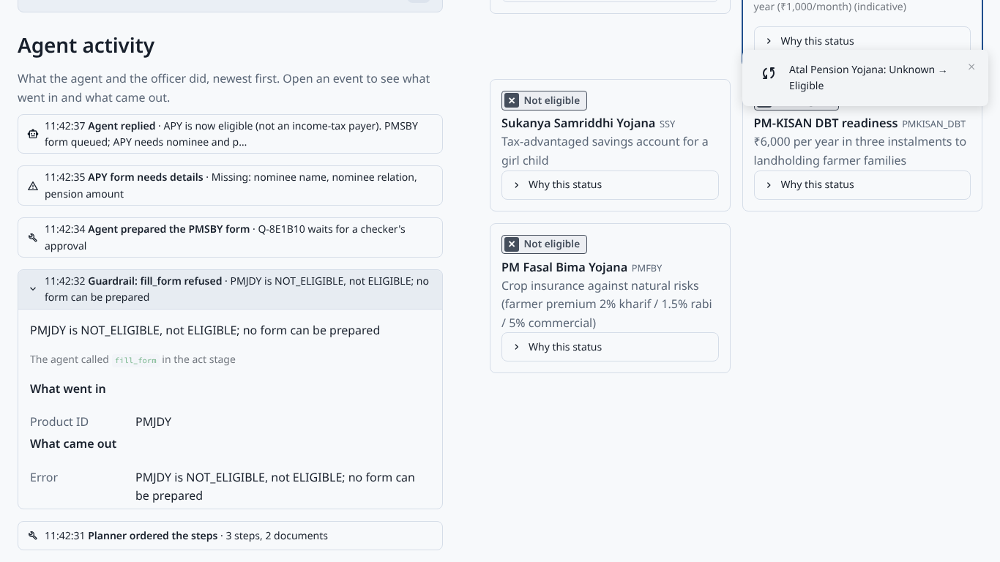 |

## Approval queue (#19)

Escalated items (`NEEDS_OFFICER`) come first, highlighted. Then one group per customer, revised items with a diff on top. Each card shows the real PDF page as a thumbnail ("View page" for a readable size). On the right: what it is, who prepared it, why it was rejected, and **what changed since the rejection**. Below that, **Approve** (primary), **Reject…** (a popover with a required reason) or **Edit and send back…** (also a popover). Every action ends with a confirmation toast. Reason and edit inputs are forms, so the first click always counts. At 1366×768 the revised item's diff and Approve are visible without scrolling (checked in Chromium: Approve ends at 701px).

| Priya: the diff since the rejection, ready to approve | Escalated first | "View page" |
|---|---|---|
| 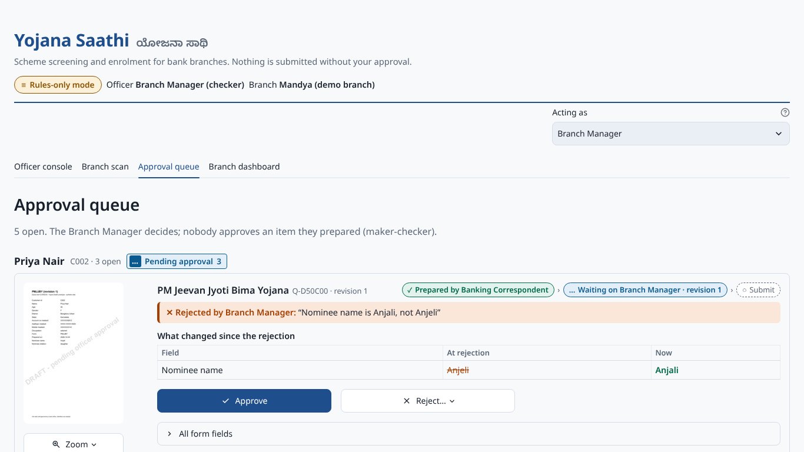 | 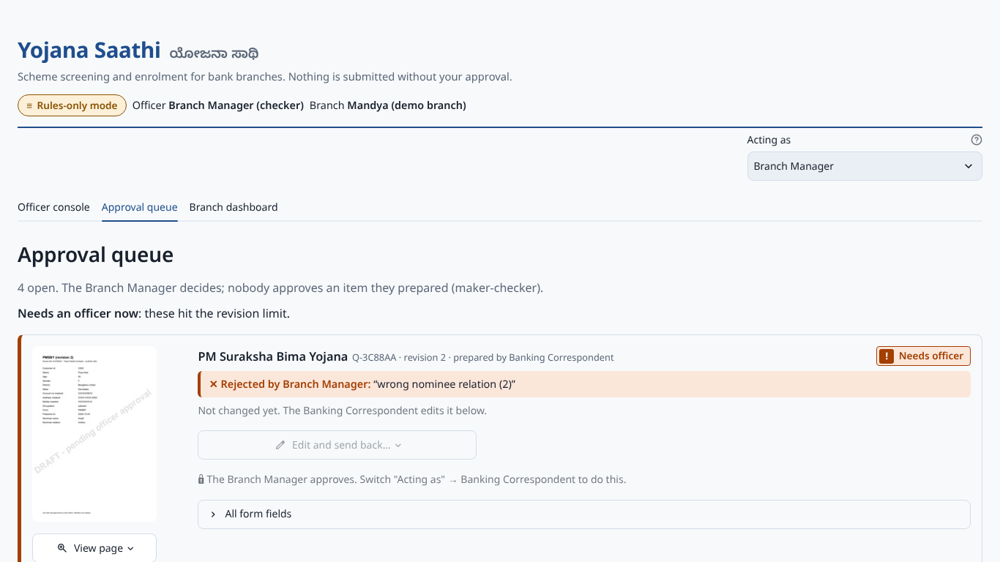 | 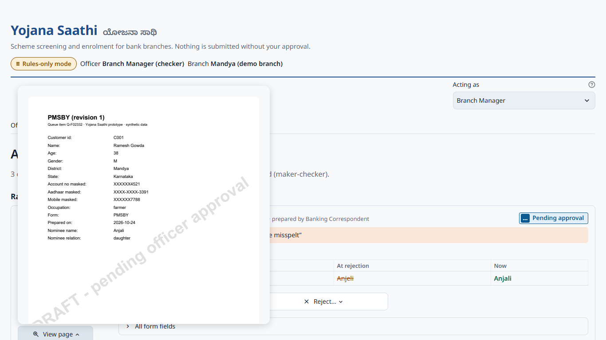 |

## Branch scan (#38)

The officer's morning to-do list, second tab. **Run scan** calls `POST /scan` (recommend-only: it queues nothing). Tiles show ₹ unclaimed (indicative, from #36, compact: "₹1.1 crore"; "—" if no listed customer has a valued scheme), customers to call, PM-KISAN payments at risk, accounts needing Aadhaar seeding, and the top product. The call list keeps the scan's ranking (urgent first), shows the top 10, and hides the filters (product, blocker, district, urgent only) in a collapsed expander. That keeps rank 1's **Start session** on screen at 1366×768 (checked in Chromium: the button ends at 736px). **Start session** on a row starts the session and switches to the Officer console. The tabs track state (`st.tabs(key="nav", on_change="rerun")`), and the switch is applied through `goto_tab` before the tabs are drawn. For the Branch Manager the buttons are locked, as in the picker (maker-checker).

| Call list | Filtered: urgent only | One click later: the console |
|---|---|---|
| 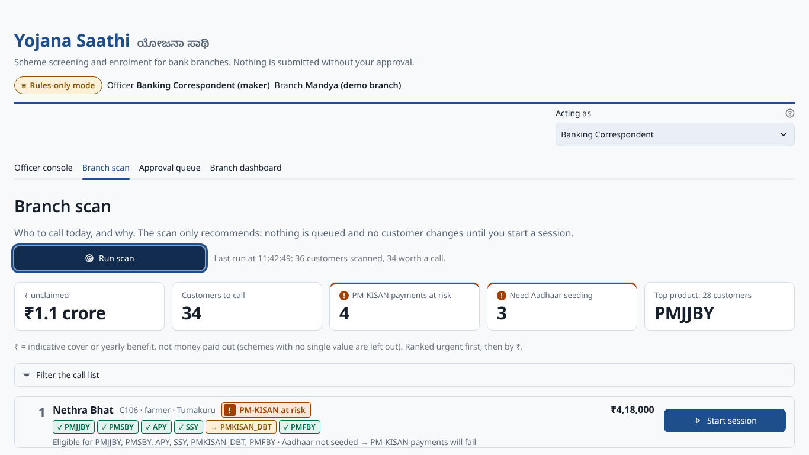 | 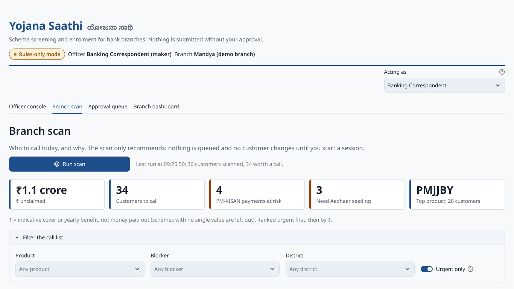 | 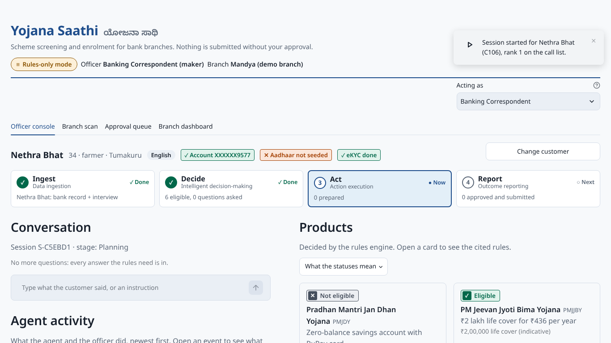 |

## Branch dashboard (#21)

The Report stage, fourth tab. It's **read-only**: one `GET /dashboard` and one `GET /audit` per rerun (`/audit/facets` is cached for 10 s), no polling, and no button that approves, rejects, revises, acts or records facts. Top to bottom:

1. **Header:** "Branch outcomes · Latest session per customer · indicative values", plus **Refresh**.
2. **KPI rows** (`kpi_tiles`):
   - Customers screened · Products eligible · Pending approval · Approved · Escalated (attention when > 0) · Avg. time to approval (`format_minutes`; "—" when there's nothing to average)
   - ₹ unlocked · ₹ eligible, not yet enrolled · Rejected (attention when > 0), with the indicative-value caption from #36
3. **Enrollment funnel** (`funnel_chart`): screened → eligible → queued → approved, each bar with its count, the % of the previous stage (not on "eligible", which counts products rather than customers) and ₹ on eligible / approved. Under it, one sentence built from the data (`funnel_sentence`).
4. **Eligibility by product** (`product_status_chart`): 7 stacked bars coloured from `STATUS` (`status_scale`, legend in `status_legend` order). Clicking a bar sets `st.session_state["dash_product"]`, and "Filtered: … ✕ Clear" appears.
5. **Three panels** (`count_chart` over `panel_counts`): blocked by a prerequisite, most common not-eligible rules (rule text; the id is in the tooltip), and most common missing documents. They count customers within the product filter. Clicking a bar adds a second filter (rule / blocker / doc).
6. **Customers in this view** (`result_table` over `filter_results`): customer, product, status, reason / blocker, queue status, ₹ value ("—" when null). Read-only.
7. **Sessions by stage** (`stage_chips`): one chip per state; ESCALATED uses the attention tone when > 0.
8. **Audit log:** Session / Actor / Event (multi) / Search filters from `/audit/facets` and `?q=`; Time, Session, Actor, Event, Details (200 chars); "Showing N of M events". Selecting a row shows its full JSON, redacted as stored.

On an empty DB the tiles read 0 / "—" and the charts are replaced by "Run a session to see outcomes".

## Screenshots

| | 1366×768 (projector) | 820px (tablet) |
|---|---|---|
| Officer console |  | 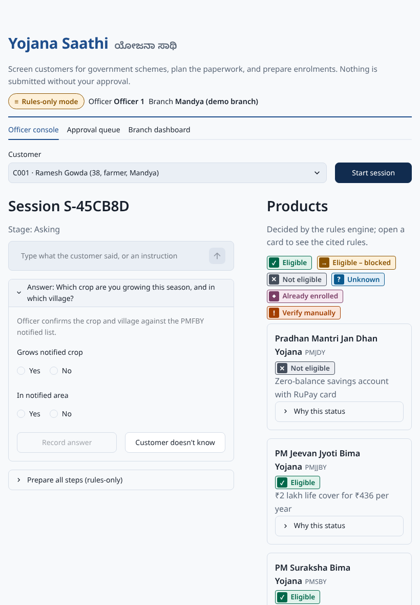 |
| Approval queue |  | 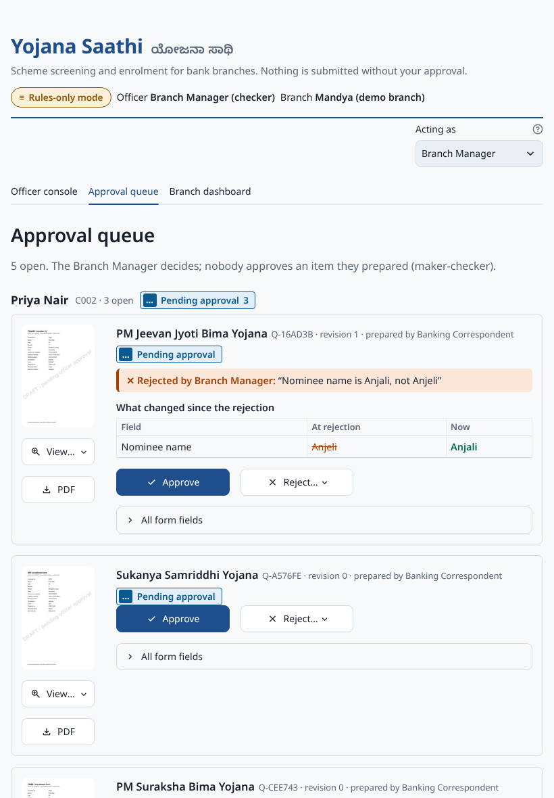 |
| Branch dashboard | 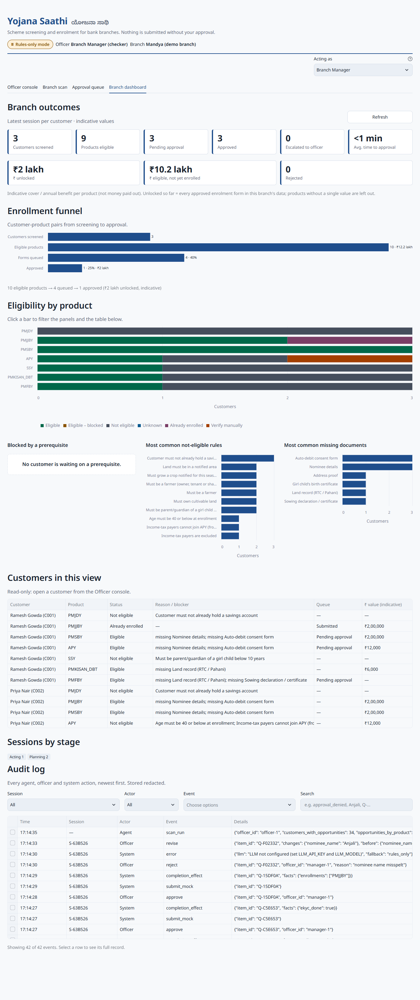 | 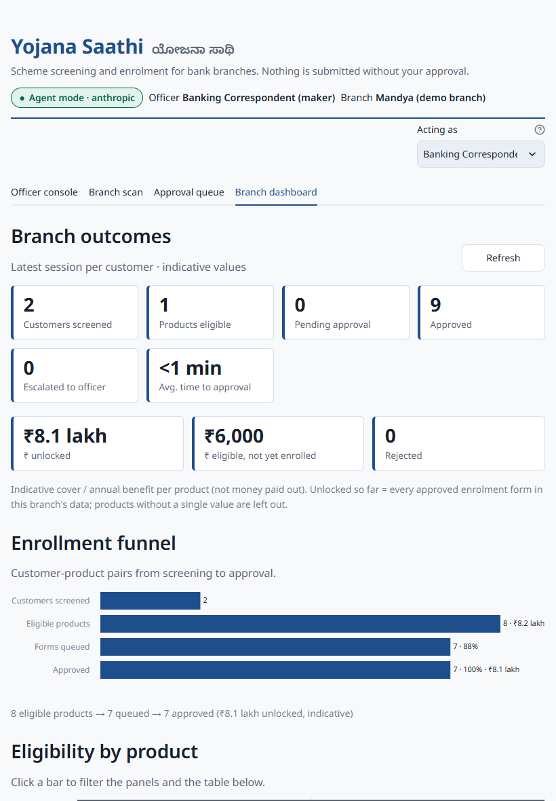 |
